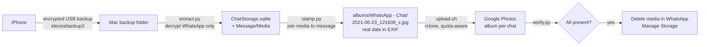

<div align="center">

# whatsapp-to-google-photos

**Get years of WhatsApp photos and videos off your iPhone and into Google Photos, with the real date each one was sent and one album per chat.**

[](LICENSE)


[](https://github.com/bluzername/whatsapp-to-google-photos/actions/workflows/ci.yml)
[](AGENTS.md)

</div>

---

WhatsApp quietly fills your iPhone. The usual escape hatch, "Save to Camera Roll" plus a photo backup app, loses the things that make the pictures findable: **every image gets the date you saved it, not the date it was sent, and nothing knows which chat it came from.** Media received before you turned auto-save on is never backed up at all.

This toolkit reads WhatsApp's own database out of an encrypted local iPhone backup, joins every photo and video to the message it arrived in, writes the true send date into the file, and uploads it to Google Photos in an album named after the chat. Then you can safely clear WhatsApp's media on the phone.

Tested on a real archive: **58,729 files, 14 GB, 1,127 chats.**

## What you get

| | Camera Roll auto-save | **whatsapp-to-google-photos** |
|---|---|---|
| Date on each photo | Date it was saved to the phone | **Date it was sent in WhatsApp** |
| Grouping | One undifferentiated pile | **One album per chat or group** |
| Media from before auto-save was on | Missing | **Included** |
| Videos | Yes | **Yes, with QuickTime dates fixed** |
| Frees iPhone storage | No, it duplicates | **Yes, once verified** |

Once it is in Google Photos you get face grouping, search ("beach 2019", "receipts"), and a clean place to decide what to keep.

## How it works



The key join, inside WhatsApp's Core Data store:

```sql
ZWAMEDIAITEM.ZMEDIALOCALPATH  -- file on disk
  -> ZWAMESSAGE.ZMESSAGEDATE   -- seconds since 2001-01-01 UTC (Apple epoch)
  -> ZWACHATSESSION.ZPARTNERNAME -- chat or group name
```

iPhone WhatsApp filenames are random UUIDs, so the filename-based date fixers that work for Android (`IMG-20200101-WA0001.jpg`) cannot help here. The database can.

## Quick start

Requirements: a Mac, a USB cable, about 2x your WhatsApp media size in free disk space, and a Google account.

```bash
brew install libimobiledevice exiftool rclone
git clone https://github.com/bluzername/whatsapp-to-google-photos.git
cd whatsapp-to-google-photos
python3 -m venv .venv && source .venv/bin/activate
pip install -r requirements.txt
```

**1. Make an encrypted backup.** `extract.py` reads encrypted backups only, and encryption keeps your chat database protected on disk.

```bash
idevicebackup2 -i encryption on   # once; prompts for a password you will remember
idevicebackup2 backup --full ~/Library/Application\ Support/MobileSync/Backup
```

Unlock the phone and tap **Trust** when asked. Finder's "Back Up Now" with "Encrypt local backup" works too.

**2. Extract WhatsApp's database and media.** Run this in Terminal with **Full Disk Access** (System Settings > Privacy & Security). It asks for the backup password and never stores it.

```bash
python3 scripts/extract.py            # writes ~/WhatsAppArchive/raw
```

**3. Stamp dates and sort into albums.**

```bash
python3 scripts/stamp.py              # writes ~/WhatsAppArchive/albums + manifest.csv
```

**4. Connect rclone to Google Photos** with your own OAuth client (see [Google setup](#google-setup)). Then:

```bash
rclone config create gphotos googlephotos client_id=YOUR_ID client_secret=YOUR_SECRET
```

**5. Upload.** It runs unattended for as long as it takes and survives daily quota resets.

```bash
nohup caffeinate -i -s scripts/upload.sh >/dev/null 2>&1 &
scripts/status.sh                     # 12345/58729 (21%) | 3700 files in last hour | ~12h left | ...
```

**6. Verify, then free the space.**

```bash
python3 scripts/verify.py             # lists any album with files missing in Google Photos
```

When it reports nothing missing, open WhatsApp > Settings > Storage and Data > Manage Storage and delete media chat by chat. Check a few albums in Google Photos first. You are the last line of defense here, and this toolkit never deletes anything for you.

## Google setup

rclone's built-in OAuth client is shared by every rclone user, and its daily upload quota runs out fast, so use your own. It takes about five minutes and costs nothing.

1. [Google Cloud Console](https://console.cloud.google.com/) > new project.
2. **APIs & Services > Library > Photos Library API > Enable.**
3. **OAuth consent screen:** External, Testing mode, add your own Google account as a **test user**.
4. **Credentials > Create credentials > OAuth client ID > Desktop app.** Copy the client ID and secret.
5. Run the `rclone config create` command above and sign in with the test-user account. Click **Advanced > Go to app** on the "unverified app" screen; it is your own app.

> [!NOTE]
> In Testing mode Google expires the refresh token after **7 days**. A full run on a large archive takes 3 to 4 days, which fits. If it expires, run `rclone config reconnect gphotos:` and restart `upload.sh`; nothing is uploaded twice.

## Limits and what to expect

| Thing | Reality |
|---|---|
| Throughput | About 3,000 to 4,000 files per hour when Google is not throttling |
| Daily quota | Photos Library API allows about 10,000 requests per project per day. Expect roughly 16,000 to 18,000 files per day |
| Quota reset | Midnight US Pacific time. `upload.sh` sleeps until 15 minutes after that, then continues |
| A 60,000-file archive | About 3 to 4 days of unattended uploading |
| Storage | Uploads count against your Google storage at original quality |

## Known issues, handled for you

Every one of these happened during a real run. `upload.sh` deals with each:

- **Daily quota (`429 ... All requests per day`)**: rclone is stopped immediately instead of burning more requests, and the script sleeps until the reset.
- **rclone freezes mid-pass** with zero network traffic: a watchdog restarts it after 15 minutes without a completed file.
- **`--gphotos-batch-mode async` crashes rclone 1.75.2** (nil pointer in `setMetaData`): the script uses `sync` mode.
- **`409 ABORTED` / `concurrent write request`**: transient; the file is retried on the next pass.
- **"There was an error while trying to create this media item"**: Google rejects some tiny WhatsApp cache files (for example 32x32 PNG icons saved as `.jpg`). These land in the Unmatched album and are not real photos.
- **Each pass re-lists every album**, which costs quota. After a non-quota failure the script waits 10 minutes instead of hammering the API.

## What is not covered

- **Voice notes, documents and stickers** stay in WhatsApp. They are a small share of the storage.
- **Media you never downloaded** (the blurry "tap to download" ones) is not on the phone, so it is not in the backup. Download anything important in the chat first.
- **Files with no matching message** (about 10% in testing) go to `WhatsApp - Unmatched (no date)` without a date.
- **Android** keeps WhatsApp media in plain folders with dated filenames. Simpler tools already cover it.
- **Google Photos API scope:** since March 2025 apps can only see and manage media they uploaded themselves. Albums are created fresh; existing albums are never touched, and nothing is ever deleted.

## Privacy and safety

- Everything runs on your Mac. Nothing goes anywhere except your own Google account through your own OAuth client.
- The backup password is read with `getpass` and is never written to disk or logs.
- Keep `~/WhatsAppArchive` private: it contains your full chat database. Delete it when you are done.
- When finished, revoke the app at [myaccount.google.com/permissions](https://myaccount.google.com/permissions) and turn off Terminal's Full Disk Access.

## Project layout

```
scripts/
  extract.py   decrypt ChatStorage.sqlite + photos/videos from the encrypted backup
  stamp.py     join media to messages, write EXIF/QuickTime dates, sort into per-chat albums
  upload.sh    rclone loop: quota-aware, stall watchdog, resumable
  status.sh    one-line progress with last-hour rate and ETA
  verify.py    compare local albums with Google Photos and list anything missing
tests/         pytest unit tests for the date, naming and verification logic
AGENTS.md      instructions for AI coding agents running this pipeline
```

## For AI agents

This repo is designed to be run by an agent such as Claude Code, Codex or Cursor with a human in the loop. [AGENTS.md](AGENTS.md) lists the exact steps, the points where the human must act (Trust prompt, backup password, OAuth sign-in, final deletion) and how to read the logs.

## Contributing

Issues and pull requests are welcome, especially for:

- Windows support (iTunes backup paths)
- Uploading to iCloud Photos or Immich instead of Google Photos
- Recovering dates for the unmatched files

Run `pytest` before opening a pull request.

## License

[MIT](LICENSE)
